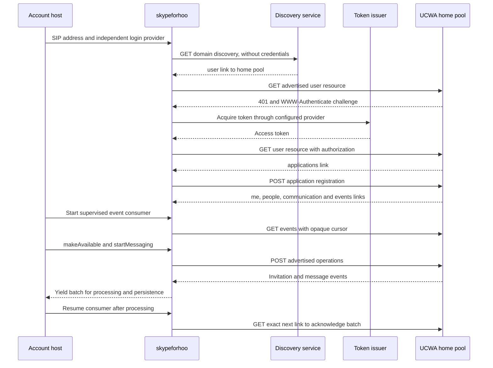
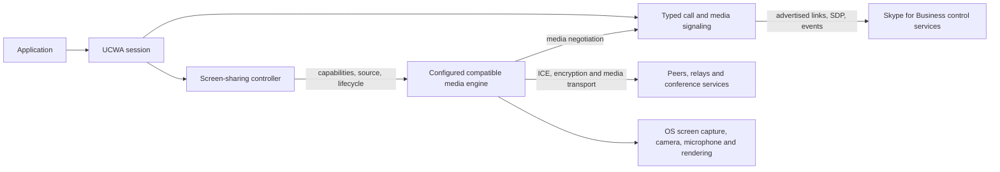

# API and runtime map

This map separates the server's control protocol from the media implementation that sends microphone, camera, or screen content. The implementation follows server links and keeps deployment-specific service names out of the API.

## Account discovery and messaging

Each new origin must pass the transport policy before receiving a request. Token acquisition has the same HTTPS and origin checks as API calls. An identity provider can implement a deployment's authentication flow without changing the resource or event APIs. The login username can differ from the SIP address.

## Calls and screen sharing

`session.media` controls documented audio/video operations and reads media policies, relay information, negotiation resources, participants, and sharing state. It also exposes conditional `startApplicationSharing`, `addApplicationSharing`, and `stopApplicationSharing` extensions observed in native clients. Each requires the exact advertised relation. SDP is supplied or consumed by the compatible media engine. A successful control request is not proof that a media path is established.

`session.screenSharing` owns the backend lifecycle for sending a desktop/window or receiving a shared screen. Its capabilities come from the configured backend. It fails explicitly when no compatible backend or requested direction/source is available. The SDK does not manufacture an undocumented UCWA screen-sharing endpoint.

The public `applicationSharing` reference describes state inspection and says sharing/viewing content is unsupported in that API version. Other references expose negotiation resources and a video-based-screen-sharing policy. Native clients include additional sharing operations; the SDK labels their evidence and unverified deployment behavior. These references and extensions do not establish a complete interoperable engine for an arbitrary server. Consult the [media guide](media.md) for the supported API boundary and native protocol requirements.

An initialized engine can observe the existing event stream through `handleEvents`. Its handler runs before a batch reaches the host, so a handler failure retains the cursor for replay. Media initialization remains lazy. Both the host and engine must handle replayed batches idempotently.

Session shutdown aborts media operations and starts native cleanup alongside deleting the UCWA application. A bounded cleanup attempt can fail with `MediaCleanupTimeoutError`; it does not establish that native resources have been released. Late results still receive cleanup, and the host can retry `close()`.

## Implementation entry points

| Layer | Source | Responsibility |
| --- | --- | --- |
| Public account client | `src/client.ts` | Configure identity, discovery, origin policy, and optional media factory |
| Discovery | `src/discovery.ts` | Follow root/user/application relations |
| Authentication | `src/auth.ts` | Supplied Bearer tokens or advertised MsRtcOAuth password grant |
| HTTP transport | `src/transport.ts` | Origin checks, redirects, cancellation, bounded authentication retry |
| Resources | `src/resources.ts` | Read/follow/invoke HAL relations |
| Session | `src/session.ts` | Contacts, presence, messages, event acknowledgment and registration cleanup |
| Media signaling | `src/media.ts` | Call operations, SDP negotiation and media resource access |
| Media engine integration | `src/media-engine.ts` | Host backend capabilities and screen-sharing lifecycle |
| Public reference catalog | `src/catalog.ts` | Index of documented resource names, verbs and primary references |

## Desktop integration

The planned Tauri application owns native credentials, media permissions, the compatible engine process, message persistence, and UI state. React and shadcn render the account data and capabilities. A separate Teamwire connector maps that provider into the common app model. The [desktop brief](desktop-app.md) records this integration direction.

## Primary protocol references

- [UCWA root URL and discovery](https://learn.microsoft.com/en-us/skype-sdk/ucwa/rooturl)
- [Authentication in UCWA](https://learn.microsoft.com/en-us/skype-sdk/ucwa/authenticationinucwa)
- [UCWA application](https://learn.microsoft.com/en-us/skype-sdk/ucwa/application_ref)
- [Events and acknowledgment](https://learn.microsoft.com/en-us/skype-sdk/ucwa/events_ref)
- [Audio/video negotiation](https://learn.microsoft.com/en-us/skype-sdk/ucwa/audiovideonegotiation_ref)
- [Application-sharing reference and limitations](https://learn.microsoft.com/en-us/skype-sdk/ucwa/applicationsharing_ref)
- [Communication policies and supported modalities](https://learn.microsoft.com/en-us/skype-sdk/ucwa/communication_ref)
