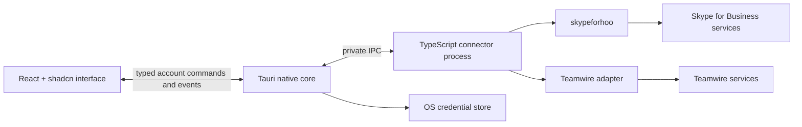

# Desktop app direction

Status: design brief for the application that follows the SDK. Research checked on November 4, 2026. The desktop application is not implemented in this repository.

## Requested stack

- Tauri desktop shell and native integration.
- React with TypeScript for the interface.
- shadcn/ui, including its chat components.
- A Skype for Business connector using `skypeforhoo`.
- A separate Teamwire connector using the chosen Teamwire SDK or client adapter.
- A modern, compact messaging interface with one place to find conversations across both accounts.

## Interface direction

Use a narrow account/navigation rail, a conversation list, and a flexible transcript. Open contact details, shared files, or a reply context in a resizable side panel. Keep the selected account and destination visible in the conversation header and composer. Grouping by person can be a presentation choice, while every conversation retains its provider and account identity.

Take inspiration from Slack's unified navigation and activity views, and Linear's compact inbox, keyboard navigation, and contextual actions. These are interaction references; the app will have its own visual identity. Use restrained color, readable message density, clear unread markers, useful empty states, and light and dark themes. Sources: [Slack's interface overview](https://slack.com/blog/productivity/a-redesigned-slack-built-for-focus), [Linear Inbox](https://linear.app/docs/inbox).

The proposed initial layout is:

```text
┌─────────┬──────────────────────┬────────────────────────────────┬──────────────────┐
│ Accounts│ Search / New message │ Person or group · provider     │ Details / files  │
│ Inbox   │ Unread / All         ├────────────────────────────────┤ (optional)       │
│ Chats   │                      │ Earlier messages               │                  │
│ Contacts│ Conversation list    │ Date and unread markers        │                  │
│ Calls   │                      │ Messages / delivery status     │                  │
│         │                      ├────────────────────────────────┤                  │
│ Settings│ Connection status    │ Reply / attach / compose / send│                  │
└─────────┴──────────────────────┴────────────────────────────────┴──────────────────┘
```

Keyboard navigation must work across conversation selection, transcript, search, message actions, and composer. Keep focus stable when incoming messages arrive. Preserve the visible message when older history is prepended, and offer a jump-to-latest control when the reader is away from the end. Validate these behaviors with real enterprise message histories before selecting any additional virtualization layer.

## Use the current official shadcn chat primitives

shadcn/ui added `MessageScroller`, `Message`, `Bubble`, `Attachment`, and `Marker` in June 2026. These provide a direct starting point for the requested chat UI. Source: [official chat component announcement](https://ui.shadcn.com/docs/changelog/2026-06-chat-components).

| Area | Components | App responsibility |
| --- | --- | --- |
| Transcript | `MessageScrollerProvider`, `MessageScroller`, `MessageScrollerViewport`, `MessageScrollerContent`, `MessageScrollerItem`, `MessageScrollerButton` | Stable provider-scoped message IDs, history loading, read position, and navigation |
| Message rows | `Message`, `Bubble`, `Avatar`, `DropdownMenu`, `Tooltip` | Sender identity, timestamps, sending/failed/delivered state, provider capability checks |
| Files and markers | `Attachment`, `Marker`, `Badge` | Transfer state, safe previews, unread/date/system markers |
| Navigation | `Sidebar`, `Resizable`, `Command`, `Tabs` | Account and conversation selection, search, shortcuts |
| Composer | `Textarea` or `InputGroup`, `Button`, `Popover` | Drafts, attachments, reply context, typing updates, IME-safe send behavior |
| Settings and status | `Dialog`, `Sheet`, `Field`, `Alert` | Account setup, reconnect state, unsupported feature explanations |

The scroller provides position and anchoring behavior without owning the transport or message state. Wrap every direct transcript row in `MessageScrollerItem`; use the SDK's stable IDs as the basis for its `messageId`. Sources: [Message Scroller](https://ui.shadcn.com/docs/components/base/message-scroller), [Message](https://ui.shadcn.com/docs/components/base/message), [Attachment](https://ui.shadcn.com/docs/components/base/attachment).

AI Elements and their prompt inputs are additional options for the composer, but enterprise messaging does not require an AI SDK. Keep message content, calls, presence, receipts, and synchronization in the account adapters and application store. Source: [shadcn Prompt Input](https://ui.shadcn.com/docs/ai-elements/base/prompt-input).

### Community components to evaluate

| Project | License | Public activity snapshot | Evaluation |
| --- | --- | --- | --- |
| [shadcn/ui](https://github.com/shadcn-ui/ui) | MIT | Last push reported November 4, 2026 | Preferred foundation, including the official chat primitives |
| [jakobhoeg/shadcn-chat](https://github.com/jakobhoeg/shadcn-chat) | MIT | Last push reported August 12, 2025; repository not archived | Useful chat layout and bubble reference; review compatibility before copying components |
| [ibelick/prompt-kit](https://github.com/ibelick/prompt-kit) | MIT | Last push reported September 28, 2026; repository not archived | Optional source for selected AI-oriented composer and message interactions |

Activity dates are GitHub metadata snapshots, not a promise of maintenance. Recheck React compatibility and dependencies when the app is built. Preserve the relevant license notices for copied components. Sources: [shadcn license](https://github.com/shadcn-ui/ui/blob/main/LICENSE.md), [shadcn-chat license](https://github.com/jakobhoeg/shadcn-chat/blob/master/LICENSE), [prompt-kit license](https://github.com/ibelick/prompt-kit/blob/main/LICENCE.md); GitHub repository metadata for [shadcn/ui](https://api.github.com/repos/shadcn-ui/ui), [shadcn-chat](https://api.github.com/repos/jakobhoeg/shadcn-chat), and [prompt-kit](https://api.github.com/repos/ibelick/prompt-kit).

## Connector boundaries

The UI talks to a common application interface. Each provider adapter maps its native resources, identifiers, event cursors, and capabilities into that interface. Namespace every stored identifier by provider and account, such as `(provider, accountId, nativeId)`. Linking two contact cards must not merge their conversation histories or change message destinations.

Suggested application operations are `connect`, `disconnect`, `listConversations`, `loadMessages`, `sendMessage`, `setTyping`, `markRead`, `searchContacts`, and an event subscription. Unsupported operations return a capability result that the UI can act on. Features such as reactions, file transfers, groups, and calling remain independently enabled for each account.

The public Teamwire SDK documentation describes a Python bot connection with `appid`, `secret`, and `host`. It does not establish that a TypeScript client can sign in as a human user through the same flow. Before app integration, choose and validate a Teamwire user connector separately; do not treat a bot's credentials as interchangeable with a person's account. Source: [Teamwire SDK connection reference](https://sdk.teamwire.eu/api/2.0/connection/).

`skypeforhoo` supplies UCWA discovery, authentication integration, resources, and events. A successful HTTP request does not prove end-to-end delivery or audio compatibility. The app must correlate operation results with protocol events and expose incomplete or failed operations accurately.

## Tauri and SDK execution

Tauri separates the WebView frontend from its native core, with capabilities controlling the exposed IPC commands. Use narrowly scoped account commands and events; avoid a generic command that accepts an arbitrary URL, credential handle, and request body. Sources: [Tauri security model](https://tauri.app/security/), [capabilities](https://tauri.app/security/capabilities/).

The recommended design for keeping reusable TypeScript SDKs outside the renderer is an application-owned connector process, started and supervised by Tauri. A packaged JavaScript runtime is an explicit dependency of this design; Tauri does not automatically provide Node.js. Tauri documents a Node.js sidecar approach for desktop systems. Source: [Node.js as a sidecar](https://tauri.app/learn/sidecar-nodejs/).



Keep stored passwords, refresh tokens, and persistent session secrets in native credential storage. Pass account handles and application data to React. Use a native account sign-in flow where possible; if a web form collects a password, keep it transient and avoid persisting it in application state or logs. Verify macOS, Windows, and Linux credential-store behavior before release. Tauri Stronghold is an encrypted vault option with its own unlock design; it is a different choice from an OS keychain. Source: [Stronghold](https://tauri.app/plugin/stronghold/).

For an alternative where SDK orchestration runs in the WebView, inject a native HTTP transport and keep authentication in a native broker. That requires explicit handling of credentials and response headers at the broker boundary. Tauri's HTTP plugin provides native HTTP requests and URL scopes; it does not automatically solve SSO, certificate trust, token audience, or media compatibility. Source: [HTTP client plugin](https://tauri.app/plugin/http-client/).

Use system certificate trust and explicitly approved service origins. Keep redirect and credential-origin rules in the broker and SDK. The SDK already accepts an injected fetch implementation; the desktop integration must verify manual redirect behavior, aborts, long polling, and access to authentication headers with its chosen native transport.

## Media and account behavior

Treat the two providers as separate call engines behind one call UI. Signaling, media credentials, codecs, conferencing, screen sharing, and device permissions need independent qualification. Do not infer media compatibility from a shared-looking call button or a successful REST call. The first useful app milestone is reliable sign-in, contacts, receiving messages, sending messages, and reconnecting on each provider.

Default to displaying both providers together while sending each message only to the selected conversation's provider. Cross-provider forwarding or bridging would be a separate explicit feature. Keep local caches, drafts, search results, connection status, and logout behavior scoped to an account.

## Implementation sequence

1. Publish and validate the `skypeforhoo` SDK with synthetic fixtures and an explicit record of real-server qualification.
2. Select and validate the Teamwire user connector and its supported API versions.
3. Build a Tauri shell and React UI with synthetic conversations using the official shadcn chat primitives.
4. Add account commands and the connector process, then connect one provider at a time.
5. Qualify receipt semantics, history, reconnect, credential storage, keyboard/screen-reader behavior, and desktop notifications.
6. Add provider-specific attachments and calls after their protocol and media behavior is proven.

This document records a future application direction. It does not claim an implemented Teamwire connector, a working desktop app, or qualified media support.
