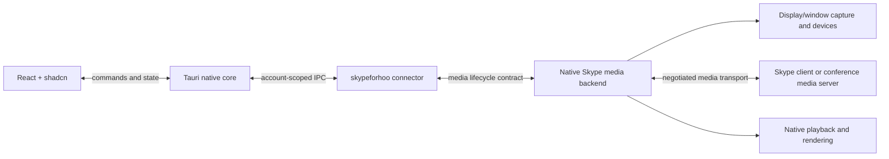

# Audio, video, and screen sharing

Protocol research checked on November 4, 2026. Version `0.2.0` implements typed signaling and a host-engine lifecycle. This document also maps the native backend work still needed for the planned macOS and Windows desktop client. No native media backend or real authenticated media qualification is included in this release.

## What constitutes working media

A complete implementation needs call signaling, a compatible media transport, codecs, local capture or playback, and a session lifecycle. `skypeforhoo` can expose UCWA resources and exchange SDP. Its host media interface connects an application-owned engine. The package does not include an engine that captures, transmits, receives, or renders Skype for Business media.

Keep these capabilities independent:

| Capability | Required implementation |
| --- | --- |
| Read sharing state and identify the sharer | Advertised UCWA resources and events |
| Control an audio/video invitation | Advertised UCWA operations and correctly encoded parameters |
| Hear or send audio | Compatible native audio transport, negotiated codec, devices, and call signaling |
| View or send camera video | Compatible native video transport, negotiated codec, capture/playback, and call signaling |
| View a shared screen | Compatible RDP or VBSS receiver, decoding, rendering, and session binding |
| Share a desktop/display | Capture, compatible sharing publisher, and session binding |
| Share a selected window | Window capture/filtering and a sharing mode that supports it |
| Grant or take remote control | A separately implemented control protocol and input integration |

An HTTP success response, an SDP round trip, or an installed screen-capture API does not demonstrate that a remote Skype participant can see or hear the result. A backend's capability declaration is its contract; qualification against the target server and native clients supplies the interoperability evidence.

## SDK entry points

`session.media` is the typed signaling interface. It shares the session's authenticated transport and lifecycle; it does not start another event consumer.

| API | Meaning |
| --- | --- |
| `communicationCapabilities()` and `capabilities(resource)` | Inspect advertised relations. These booleans describe the server resource, rather than the installed engine's media support. |
| `startAudio()`, `startVideo()`, `startAudioVideo()` and corresponding `add*()` methods | Invoke an advertised call operation. An optional `mediaOffer` is raw SDP generated by a compatible engine and encoded as an inline UCWA media resource. |
| `acceptWithAnswer()` and `sendProvisionalAnswer()` | Send an engine-generated SDP answer with the required `sessionContext`. |
| `decline()`, `cancel()`, `stopAudio()`, `stopVideo()`, `stopAudioVideo()`, `endConversation()` | Control the advertised invitation, modality, or conversation lifecycle. |
| `audioVideo()`, `audioVideoSession()`, `audioVideoNegotiation()` | Read media resources for event handling and backend negotiation. |
| `applicationSharing()` and `applicationSharer()` | Read sharing state and participant information. These methods do not return a screen stream. |
| `mediaRelayAccessToken()`, `mediaRelays()`, `mediaPolicies()` | Read the advertised relay and policy data needed by a backend. Relay credentials and SDP can contain secrets; keep them out of public diagnostics. |

`encodeSdpDataUri()`, `decodeSdpDataUri()`, and `mediaDescription()` handle inline `application/sdp` resources. They do not create codecs, ICE candidates, or media tracks. Consume asynchronous results through the application's single `session.events()` loop. That loop automatically awaits an initialized backend's optional `handleEvents(batch, context)` hook before yielding each batch to the application.

`session.screenSharing` supplies the host-engine lifecycle for starting or receiving a share, capability queries, stopping, and teardown. Without an installed compatible backend, sharing attempts fail with `UnsupportedMediaError`. Desktop publishing, window publishing, and receiving must be declared independently. The default SDK configuration does not enable them.

Configure `SkypeForHoo` with a `mediaEngine: MediaEngineFactory` to install an engine. The factory receives the application reference, typed signaling interface, optional SIP address, and account-lifetime signal. Initialization is lazy and owned by one account session. The current `MediaEngine` contract provides `capabilities()`, optional `handleEvents()`, `startScreenSharing()`, and `close()`; it does not define an audio/video capture or SDP-generation API.

The screen controller exposes:

- `capabilities(conversation?, signal?)` and `supports(query, conversation?, signal?)` for backend and account/conversation policy checks. A window-publishing query uses `{ feature: 'screenSharing', direction: 'send', captureSource: 'window' }`.
- `startScreenSharing(conversation, { source: { kind: 'desktop' | 'window', id? }, signal? })` for publishing. The optional source ID is opaque to the SDK; the backend can present its own picker when it is omitted.
- `receiveScreenSharing(conversation, { signal? })` for viewing. The backend owns the viewing surface and any native stream handle.
- `stopScreenSharing(handle?)`, the handle's `stop()`, and account/session `close()` for cleanup. Cancellation applies to startup and a running share. A handle's `finished` promise reports termination after cleanup; cleanup failures remain visible and can be retried.
- `sessions` for the controller's current handles. Handles expose their direction, source, state, error, and `finished` promise; a failed cleanup does not count as a stopped share.
- `handleEvents(batch, signal?)` as the controller hook used by `session.events()`. Applications using the session iterator must not forward the same batch a second time.

A backend must resolve startup after establishing the requested media. Returning a handle after an HTTP operation was merely accepted would violate the backend contract. The SDK validates the lifecycle interface and declared source capabilities; it cannot independently prove what an external backend transmitted.

### Event processing

Keep one event consumer per account and await application processing inside it:

```ts
for await (const batch of session.events({ signal: accountLifetime.signal })) {
  // The initialized media backend's handleEvents hook has already completed.
  await accountStore.persistAndHandle(batch);
}
```

`accountLifetime` and `accountStore` are host-owned. The backend hook and application handler must be idempotent: a backend failure leaves the current event cursor unchanged, and an application failure can replay a batch already processed by the backend. A backend hook must not await a future event batch; doing so prevents this sequential consumer from polling it.

Event forwarding does not initialize an unused backend. If inbound media negotiation needs the hook, initialize the backend with `session.screenSharing.capabilities()` before advertising or enabling that media feature. Forwarding waits for a factory initialization already in progress. A backend with independent native signaling can omit the hook, but still owns the binding to the correct account and conversation.

### Cleanup deadlines and failure reporting

`SkypeForHooOptions.mediaCleanupTimeoutMs` and `UcwaSessionOptions.mediaCleanupTimeoutMs` configure the media deadline. Direct `ScreenSharingController` construction uses `cleanupTimeoutMs`. The default is `10_000` milliseconds; the value must be an integer from `1` to `2_147_483_647`.

The deadline bounds each controller `close()` or no-argument `stopScreenSharing()` attempt, including pending native startups. Individual `handle.stop()` and `stopScreenSharing(handle)` await that handle's backend cleanup without this controller deadline. Account `session.close()` attempts media cleanup and UCWA application deletion concurrently; the HTTP deletion has the transport's separate timeout and cancellation behavior.

`MediaCleanupTimeoutError` exposes the timed-out `operation` and `timeoutMs`. It ends the caller's wait while native cleanup can continue. A timeout must leave cleanup pending in the app's state; it is not evidence that capture or transport has stopped. The controller retains late startup results and schedules their cleanup. Failed stop or close operations can be retried; observe handle `state`, `error`, and `finished`, and inspect the backend if cleanup remains unresolved. When both native cleanup and application deletion fail, `session.close()` reports an `AggregateError` containing their errors.

## UCWA's documented boundary

Microsoft's [`applicationSharing` reference](https://learn.microsoft.com/en-us/skype-sdk/ucwa/applicationsharing_ref) describes a sharing-state resource and says that the documented API version does not support viewing or sharing content. Other references expose [`applicationSharingRenegotiation`](https://learn.microsoft.com/en-us/skype-sdk/ucwa/applicationsharingrenegotiation_ref), SDP offers/answers, and a [`communication.videoBasedScreenSharing`](https://learn.microsoft.com/en-us/skype-sdk/ucwa/communication_ref) policy. These documents describe different aspects of a versioned platform. They do not establish a complete, portable sharing path for a third-party client.

Static native-client request analysis also identifies sharing operations beyond the public reference, including application-sharing and screen-sharing start/add/stop relations. These are deployment extensions with a partially inferred request contract; operation names, request call sites, and available fields do not establish the complete wire format or successful media interoperability. Proprietary binaries, generated implementation code, and symbol dumps are not part of the public SDK.

Use server-advertised relations, policy values, the selected backend, and real interoperability results together. Do not infer screen-sharing support from an enum containing `ApplicationSharing`, a scope mentioning desktop sharing, or the presence of an `applicationSharing` resource. Sharing operations must follow an advertised relation; the SDK does not invent a fixed HTTP endpoint.

Some backends can use UCWA signaling. Others, including SIPE, own a native SIP session. A backend must explicitly bind the application's conversation or meeting to its native session. A UCWA resource URL is not itself a SIP dialog identifier or a media endpoint.

### Conditional application-sharing extensions

`session.media` also exposes the following deployment extensions derived from static native-client request analysis:

| Method | Advertised relation | Request mapping and evidence |
| --- | --- | --- |
| `startApplicationSharing(options)` | `startApplicationSharing` on communication | POST with target and optional offer/session/correlation fields. Native request call sites establish POST, while metadata identifies available fields; the complete wire contract and live interoperability remain unqualified. |
| `addApplicationSharing(resource, options)` | `addApplicationSharing` on the supplied resource | Offer/session/correlation fields, without a required `to`. POST is an inferred mapping and remains unqualified. |
| `stopApplicationSharing(resource)` | `stopApplicationSharing` on the supplied resource | POST without a request body. Native request call sites establish POST; the complete wire contract and live interoperability remain unqualified. |

Each method requires its exact relation to be advertised. A missing relation raises `MissingLinkError`; no guessed path or alternative operation is substituted. Synthetic tests can verify the constructed request, but cannot confirm the inferred server contract or transmit screen frames. Other observed sharing operation names do not automatically inherit these schemas.

These are signaling methods. The similarly named `session.screenSharing.startScreenSharing()` invokes the configured media backend and waits for that backend's readiness contract. Implementations must connect those layers deliberately.

## Protocol and engine map

| Layer | Relevant protocol or component | Engine responsibility |
| --- | --- | --- |
| Invitation and conference state | UCWA when supported; native SIP and conference control for a native endpoint | Offers, answers, invitation results, renegotiation, meeting membership, and native session binding |
| Connectivity | [MS-ICE2](https://learn.microsoft.com/en-us/openspecs/office_protocols/ms-ice2/8cd2fe91-1aa6-49e1-b482-f92b5c40b7e2) and the deployment's relay/edge services | Candidate gathering, connectivity checks, relay credentials, TCP/UDP behavior, and cleanup |
| Protected media | [MS-SRTP](https://learn.microsoft.com/en-us/openspecs/office_protocols/ms-srtp/d9641c95-b152-4cc7-8311-d178f3241f1f) and negotiated RTP profiles | Keying and encrypted packet transport compatible with the remote endpoint |
| RDP screen sharing | [MS-RTASPF](https://learn.microsoft.com/en-us/openspecs/office_protocols/ms-rtaspf/3f92fe9a-803e-425e-9634-f296a21a1282), RDP graphics, and [MS-RDPEMC](https://learn.microsoft.com/en-us/openspecs/windows_protocols/ms-rdpemc/1c867b2b-40b8-459a-9af6-906b6e0096fc) | RDP framing over RTP/TCP, graphics, participant state, and supported sharing roles |
| Video-based screen sharing (VBSS) | H.264 and the [`applicationsharing-video` SDP label](https://learn.microsoft.com/en-us/openspecs/office_protocols/ms-sdpext/4645ac34-8a54-42a7-bb6c-977639c4b5d1) | Screen-content encoding/decoding, correct modality negotiation, and any required fallback |
| Audio and camera video | [Microsoft RTP profiles](https://learn.microsoft.com/en-us/openspecs/office_protocols/ms-rtp/dea055e9-5873-4bd2-aeaf-22c88fa56c05), including negotiated audio payloads, H.264, or RTVideo | Devices, codecs, RTP/RTCP handling, playback, loss recovery, and synchronization |
| Local desktop/window capture | Operating-system capture facilities | Source selection, permission handling, frame delivery, and capture teardown |

Microsoft's [desktop-sharing protocol walkthrough](https://learn.microsoft.com/en-us/openspecs/office_protocols/ms-ocsprot/9a258191-7897-4116-84d6-11e9a6919e13) includes SIP/SDP exchanges, ICE checks, conference notifications, and protected media. An RDP graphics library covers only part of that sequence.

### RDP sharing

The official [SDP offer example](https://learn.microsoft.com/en-us/openspecs/office_protocols/ms-sdpext/abf816a9-22af-474d-b9ba-66d327f1de45) uses `m=applicationsharing`, `TCP/RTP/SAVP`, and `x-data/90000`, together with ICE, cryptographic, and application-sharing attributes. [MS-RTASPF](https://learn.microsoft.com/en-us/openspecs/office_protocols/ms-rtaspf/3f92fe9a-803e-425e-9634-f296a21a1282) specifies RTP over TCP as the transport for RDP graphics and multiparty-sharing data. Connecting a normal Remote Desktop client to a guessed server port does not implement this path.

Sharing a selected window also has protocol semantics. [MS-RDPEMC's filtering model](https://learn.microsoft.com/en-us/openspecs/windows_protocols/ms-rdpemc/c14fd34f-a290-4941-980d-bbaf2e9f8d3a) distinguishes an explicit set of windows from all windows belonging to an application. A backend should advertise the sources it actually implements, rather than assuming desktop capture proves window sharing.

### VBSS

Microsoft documents VBSS as an H.264 screen-sharing mode for supporting clients and Skype for Business Server 2015 CU3 or later. Its [deployment guide](https://learn.microsoft.com/en-us/skypeforbusiness/manage/video-based-screen-sharing) describes transitions to RDP for scenarios including program/window sharing, remote control, and older participants. A backend that implements only a VBSS receiver must state that limitation. Camera-video support does not automatically provide a VBSS publisher.

H.264 codec availability alone also does not settle interoperability: [MS-H264PF](https://learn.microsoft.com/en-us/openspecs/office_protocols/ms-h264pf/f3024858-350e-49b0-9866-99c4fd2b912d) specifies Microsoft's RTP payload extensions. The backend must implement the mode negotiated with the remote endpoint, including product-specific behavior where applicable.

## Concrete backend candidates

These are implementation candidates and references. No candidate listed here has been integrated or qualified by this repository.

| Candidate | Evidence | Practical boundary |
| --- | --- | --- |
| SIPE with libpurple, Farstream/GStreamer, libnice, and FreeRDP | SIPE's [release notes](https://sourceforge.net/p/sipe/news/) describe viewing since `1.22.0` using Remmina or `xfreerdp`, and publishing since `1.24.0` using `freerdp-shadow2`. Its [FAQ](https://sourceforge.net/p/sipe/wiki/Frequently%20Asked%20Questions/) identifies media and SRTP dependencies. | Concrete open-source starting point for a native RDP backend. It owns extended SIP/SIMPLE signaling. Current library compatibility, server policy, packaging, and macOS support still need proof. SIPE identifies its license as `GPL-2.0-or-later`. |
| FreeRDP as an embedded library | [FreeRDP](https://github.com/FreeRDP/FreeRDP) implements RDP and is licensed under Apache-2.0. | Supplies RDP components. A complete Skype backend still needs compatible signaling, framing, connectivity, protected transport, sharing roles, and native integration. |
| Windows client bridge using Lync Client SDK | Microsoft's [Lync 2013 SDK download](https://www.microsoft.com/en-us/download/details.aspx?id=36824) documents a .NET API that controls an installed client and requires a signed-in Lync client for deployment. | Possible transitional Windows integration, dependent on the installed native client and exact version compatibility. The [Lync 2013 SDK lifecycle](https://learn.microsoft.com/en-us/lifecycle/products/lync-2013) ended on April 12, 2023. It is not a standalone macOS engine. |
| Historical Skype Web SDK or Meetings plug-in | Microsoft [retired Skype Web SDK on September 30, 2024](https://learn.microsoft.com/en-us/skype-sdk/websdk/docs/skypewebsdk). Its [meetings-client guide](https://learn.microsoft.com/en-us/skypeforbusiness/plan-your-deployment/clients-and-devices/meetings-clients) says the Web App does not install on macOS 10.15 or later. | No basis for a new supported Mac Tauri engine. Extracted proprietary binaries are not distributed by this project. |

The SIPE evidence concerns its documented RDP path. It does not establish a working VBSS implementation, a current Apple Silicon build, or compatibility with a particular organization's deployment. Its historical Adium support likewise does not establish modern Mac media support.

## Recommended route for the macOS and Windows Tauri application

Build the media backend as a separately testable native component with a small, typed control interface. For the first interoperability experiment, evaluate SIPE's existing RDP path against an authorized test account and native Skype participants. Decide whether to adapt its full native signaling stack or implement a UCWA-driven backend only after the target deployment's supported media flow is established.

For macOS, [ScreenCaptureKit](https://developer.apple.com/documentation/screencapturekit/capturing-screen-content-in-macos) supplies display/window capture. A native capture adapter still needs to feed the chosen encoder or RDP publisher. Receiving also requires a native rendering path. Neither capture nor rendering supplies Skype signaling, relay traversal, or wire compatibility.

Use the same `MediaEngineFactory` contract on Windows with a separately packaged and qualified backend. Capture selection, rendering, device permissions, process shutdown, and interoperability must be verified on each target platform. A Windows client bridge is an optional deployment-specific route; it does not qualify the standalone native backend or the macOS build.

The proposed application boundary is:



This is an integration direction. The native Skype backend in the diagram remains an implementation dependency. Keep capture handles and frame transport within the native layer where possible; send state and user actions through the UI boundary. The application's source picker and remote-view surface belong to the host backend integration.

Start by proving one supported sharing mode in both directions with a native peer. Then qualify conferences, relay-only networks, window selection, and transitions between RDP and VBSS. Treat remote control as its own feature. Add a backend to the public compatibility list only with its exact engine build, operating system, server/client versions, sharing direction, and observed result recorded.

## Media acceptance evidence

The synthetic SDK tests cover request construction, resource parsing, capability handling, and lifecycle behavior. A real media acceptance run must additionally show:

1. The native participant sees the intended desktop or window, or the SDK host renders the participant's share.
2. The negotiated sharing mode and network path are recorded without exposing credentials or session keys.
3. Stopping, logout, cancellation, remote termination, and host shutdown stop capture and release the media session.
4. Unsupported source types or server policies produce a useful error before presenting a successful sharing state.
5. For audio/video, the remote participant confirms actual sound/picture and the intended devices.

Until that evidence exists, the accurate product description is typed call signaling and an injectable media backend contract. It is not qualified screen sharing, audio calling, or video calling.
